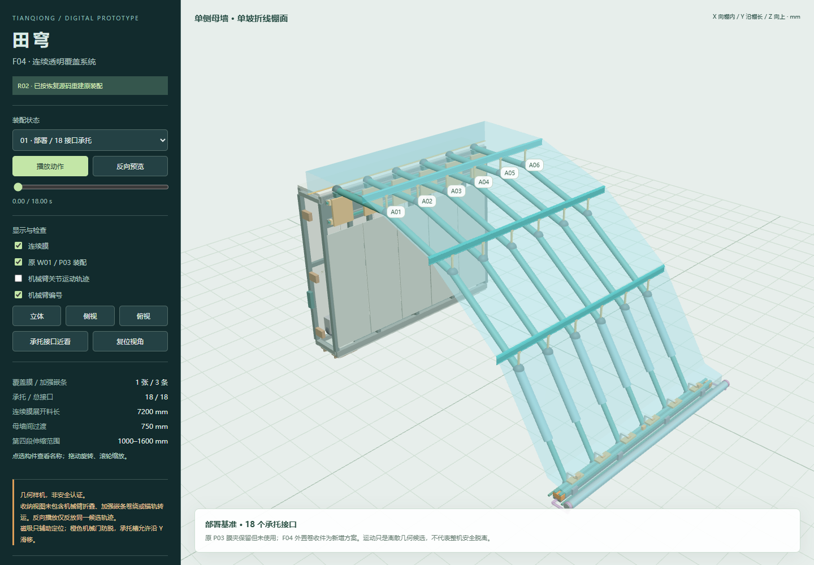

> **第二代数字样机（装配图 / 关节 / 校核 / 锚轨搬运）见 [`v2/`](v2/README.md)。** 本页与 `F04_R02/` 是第一代单模块交付物。

# 田穹 TIANQIONG · 模块化可变构智能暖棚

F04 R02 原基准对接版参数化数字样机。已按恢复的 W01 / M02 / P03 建模源码重建总装，并加入连续透明覆盖系统。

> **几何研究样机，不是制造图或安全认证。** 柔性膜仿真、结构及风雪荷载、安全控制、完整部署/收纳路径尚未完成。2/5 号臂的动作属于脱离候选，不能据此运行承载实物。

## 下载与查看

- [完整设计包 ZIP · v0.2.0](https://github.com/zl7036138-cmd/tianqiong-greenhouse/releases/tag/v0.2.0)
- [部署总装 STEP](F04_R02/01_deployed.step) · [F04 独立 STEP](F04_R02/F04_only.step)
- [部署 GLB](F04_R02/01_deployed.glb) · [18 秒运动 GLB](F04_R02/F04_sync_release_CANDIDATE_18s.glb)
- [动画预览 MP4](F04_R02/F04_motion_preview.mp4)
- [使用与设计说明](F04_R02/README_使用与设计说明.md) · [验证摘要](F04_R02/验证摘要.md)
- [小墙、端墙及收纳闭合规划](F04_R02/NEXT_小墙端墙与收纳闭合.md)

交互三维视图位于 `F04_R02/index.html`。请下载完整 ZIP 或克隆仓库，保留同目录脚本和数据后打开；GitHub 文件页不直接运行 HTML。若浏览器限制本地页面，可在 `F04_R02` 目录运行 `python -m http.server 8000`，再访问本机 `http://localhost:8000`。所有视图依赖均随包附带。

## 模型内容

- W01：3500 × 600 × 2800 mm 大型母墙。
- M02：六根四段机械臂；第 4 段伸缩范围 1000–1600 mm；每臂 7 自由度，包含根座沿棚长平移。
- P03：3500 mm 前沿锚轨、六滑块、四地锚；保留原几何基准。
- F04：一张连续膜，不按臂段裁开；三条沿棚长贯通的加强嵌条；每大模块 18 个可释放滑移承托接口。磁吸仅辅助定位，机械闸门防脱。
- 双模块：大母墙节距 4250 mm，保留 750 mm 小墙过渡与 BR750；一张膜跨越两个大模块。

包含六状态 STEP / GLB、可编辑参数和生成源码、装配关系描述、42 个机械臂关节的运动轨迹、无虚设质量/惯量的运动学 URDF，以及独立检查记录。STEP 是命名 B-rep 实体，不内置参数特征树或运动约束；参数编辑通过源码重新生成。

## 验证与未完成事项

六状态 STEP 回读有效；八个 GLB 格式验证为 0 错误、0 警告。连续膜均为单实体。73 个离散样本的指定承托头局部检查未发现与膜、嵌条、腹带的正体积交叠。**这不是全组件连续扫掠或整机安全证明。**

原 P03 腕部与实体支架的代理重叠仍存在；F04 新增外置导膜/卷收接口尚待工程化。收纳仅表示膜卷与锚轨的目标位置，未解决加强嵌条卷绕、机械臂折叠、地锚回收或锚轨转运。柔性膜材料、接触、弯曲、风雪、地锚抗拔和安全校核均未完成。

## 再生与溯源

使用 Python 3.12，在 `F04_R02` 目录按 `requirements.txt` 安装依赖，运行 `python model.py`。生成器会覆盖同名生成物，修改前请备份。检查入口为 `verify.py`、`roundtrip_check.py`、`kinematic_check.py`。

恢复源码在 `F04_R02/recovered_sources/`；源文件哈希及接口参数见 `source_alignment.json`。恢复的是历史源码，不是原下载包的二进制附件。文件完整性记录见 `SHA256SUMS.txt`。

本仓库只包含 R02 交付文件，不包含本地环境、工作缓存或旧 R01 假设版本。当前未指定项目开源许可证；第三方 Three.js 许可证单独保留于 `F04_R02/THREE_LICENSE.txt`。公开可见不代表模型已获安全批准。
