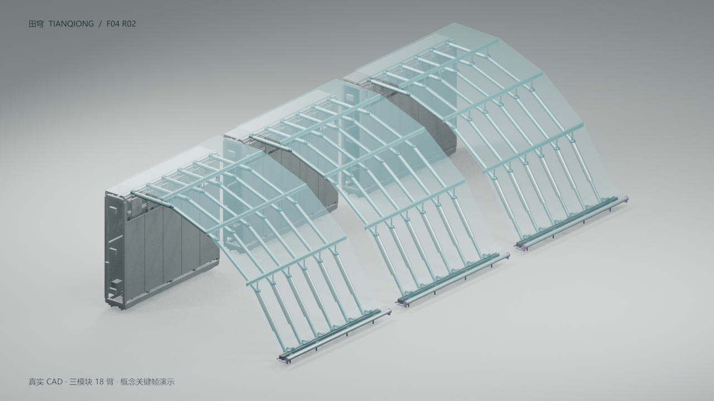

# 田穹 TIANQIONG · Blender 动画

**当前最新版本：V3（2026-10-28 用户确认）。后续从 V3 继续，默认下一版为 V4。**

## 当前交付

- [完整 V3 工程包 ZIP](versions/v3/田穹_Blender_CAD校正工程_V3.zip)
- [可编辑 Blender 工程](versions/v3/田穹_F04_R02_V3_坐标与关节校正.blend)
- [34 秒 MP4](versions/v3/田穹_F04_R02_V3_34秒_校正动画.mp4)
- [中文字幕 SRT](versions/v3/田穹_F04_R02_V3_34秒_校正动画.srt)
- [修正说明与检查范围](versions/v3/田穹_V3_检查与修正说明.md)
- [机器可读核查记录](versions/v3/田穹_F04_R02_V3_核查记录.json)
- [生成脚本](versions/v3/scripts/rebuild_checked_v3.py)、[全片接合检查脚本](versions/v3/scripts/verify_v3_full_timeline.py)
- [原 CAD 输入资产](versions/v3/source_cad/)
- [当前版本及 SHA-256 校验值](LATEST.json)

## 已核查

单模块源网格 398 个，三模块共 1194 个。恢复姿态与源 GLB 进行了 129,720 次顶点比较；全部 816 帧进行了 44,064 次杆件接合检查，并检查内管与臂端接合。误差数值及对象范围保存在核查记录。

最终视频为 1280×720、24 fps、34.000 秒、H.264/yuv420p，816 帧全部解码通过。

## 后续工作基准

Blender 导入器已自动恢复米制 Z-up：X 向棚内、Y 沿棚长、Z 向上。后续动画从 V3 的 `.blend`、生成脚本和配套输入资产派生，保留 V3 当前快照。

V3 基于历史 F04 R02，并未集成本仓库后续母墙侧收卷、整棚跨缝围护、Mode A 六段作业或新版快脱接口。动画中的折叠与膜展开为概念关键帧，膜使用原 CAD 网格的仿射变形，没有完成碰撞、真实卷绕或柔性膜仿真。

## 历史备份

[V1、V2 及自动保存备份](backups/README.md) 按原文件保留。原工程目录 `src/`、`cad/`、`studio/`、`renders/` 和历史 Git 分支保持原有内容。
